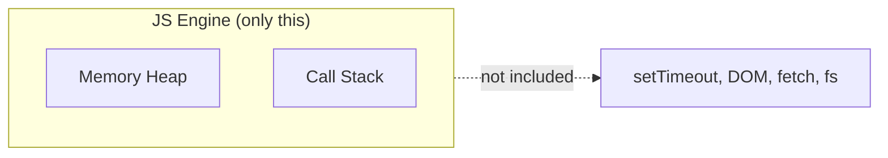
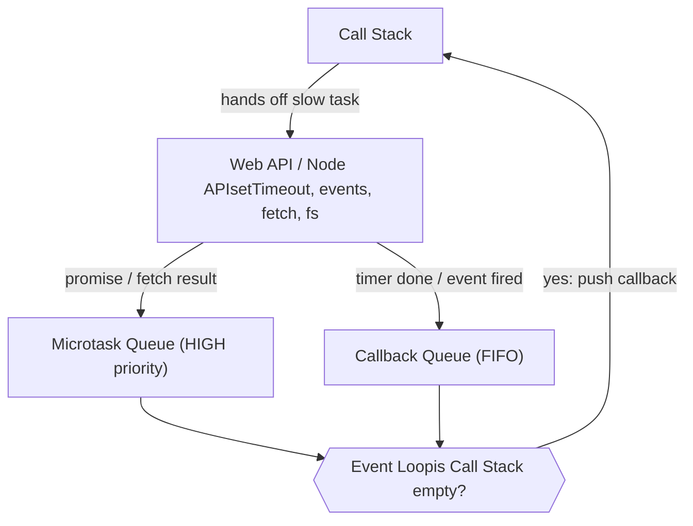
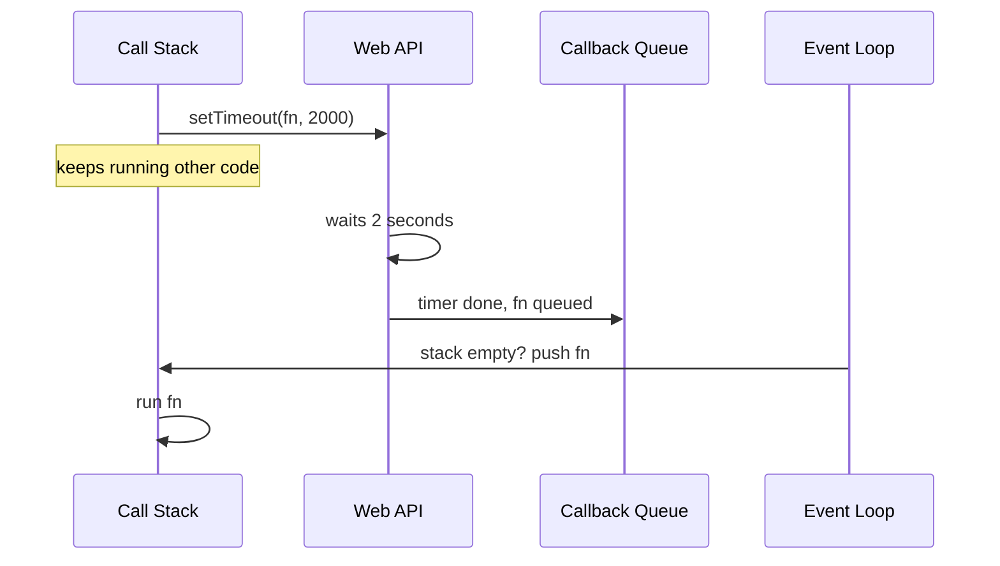
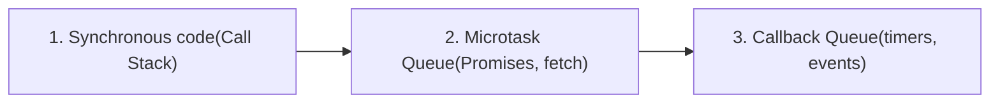

# ⚡ Async JavaScript: Visual Notes

Theory only. Revision sheet from the Chai aur Code async video.

## TL;DR

JS is **synchronous** and **single-threaded**. Async works because the **environment** (browser or Node) waits for slow tasks, and the **event loop** brings results back to the Call Stack when it is empty.

### Default behaviour, explained

**Synchronous** means code runs line by line: the next statement starts only after the previous one finishes. **Single-threaded** means there is just one thread, so only one thing happens at a time. Many other languages use several threads (one does a job, another does a different job, results get merged). JS keeps the old-school model, which is simpler but slower for heavy work. The trick is that JS never runs alone: it always lives inside a **runtime environment** (browser or Node.js) that adds extra powers.

## 1. What is inside the JS engine?



The engine is only Heap + Call Stack. Timers, DOM, `fetch` and file access come from the **environment**. The DOM exists only in browsers, not in Node.

**Recap of Execution Context:** when a program starts, a Global Execution Context is created. Each function call creates its own context and is pushed on the Call Stack, then popped when it finishes. Because there is one stack, each operation **waits for the previous one to complete**. The V8 engine (Chrome and Node.js) is written in C++; this is all it does by itself.

## 2. Blocking vs non-blocking

**🚫 Blocking**

“Sit here and do nothing until I bring water.” Everything waits.

`fs.readFileSync()`

**✅ Non-blocking**

“Keep working, I’ll tell you when the water is here.” Other code continues.

`fs.readFile(cb)`

**Neither is always better.** Registering a user? Wait for the DB result (blocking) before saying “success”, or you may show success when the save actually failed.

### Why file reading is the classic blocking problem

Your program cannot read a file directly. It must ask the **OS kernel**, which accesses the file, reads it and hands control back. The kernel may be busy with other requests, so this can take 1 second or 5. If you read synchronously, your whole program stands still for that time. If you read asynchronously, the program keeps working and gets notified when the data arrives. Browsers cannot read local files this way; that is a Node.js ability.

## 3. The full async picture



Remember: **Stack = LIFO** (plates). **Queue = FIFO** (McDonald’s line).

### What each part does

- **Web API / Node API:** provided by the environment, not the engine. It does the waiting (timers, events, network, files).
- **Callback Queue:** a waiting room. Finished callbacks line up here in first-in, first-out order.
- **Microtask Queue:** a priority lane for Promises and `fetch` results. The video calls it the “high priority queue”.
- **Event Loop:** the manager. It keeps checking whether the Call Stack is empty and, when it is, moves the next callback onto it. You never handle this yourself.

## 4. Step by step: `setTimeout`



The engine cannot wait for 2 seconds without freezing, so it hands the timer to the Web API and says “remind me later”. The API registers the callback (the same happens for `setInterval` and events like click, load, hover). When the time is up the callback joins the queue, and the event loop runs it only once the stack is free. Async code is not instant: it has to come back around.

## 5. The classic trick question

```
console.log("1");
setTimeout(() => console.log("2"), 0);
console.log("3");
```

1**→**3**→**2

`setTimeout(fn, 0)` does **not** mean “run now”. The callback still goes through the Web API and queue, and runs only after the current synchronous code ends.

**Why:** `1` runs at once. `setTimeout` is handed to the Web API even with a 0 delay, and its callback goes to the queue. `3` is already on the stack, so it runs next. Only when the stack is empty does the event loop push `2`. People get this wrong by assuming 0 means “immediately”.

## 6. Promise vs timer: who goes first?

```
console.log("start");
setTimeout(() => console.log("timeout"), 0);
Promise.resolve().then(() => console.log("promise"));
console.log("end");
```

start**→**end**→**promise**→**timeout



`fetch` also uses the Web API for the network call, but its result is handled with a Promise, so the callback lands in the **Microtask Queue**. The event loop serves that queue **before** the normal callback queue. That is why “promise” prints before “timeout” even though both were scheduled with no delay. Official names: Microtask Queue (promises) and Macrotask / Callback Queue (timers, events).

## 7. Cheat table

| Thing | Provided by | Goes to |
| --- | --- | --- |
| Normal code | JS Engine | Call Stack |
| `setTimeout`, `setInterval` | Browser / Node | Callback Queue |
| Click, load, hover | Browser | Callback Queue |
| `fetch` + Promises | Browser | **Microtask Queue** |
| File system | Node.js | Callback Queue |

## 8. Interview quick answers

- **Is JS async?** No. It is synchronous and single-threaded; the runtime adds async.
- **What does the event loop do?** Moves callbacks to the stack when the stack is empty, microtasks first.
- **Does the engine have `setTimeout`?** No, the environment provides it.
- **Promise or timeout first?** Promise.